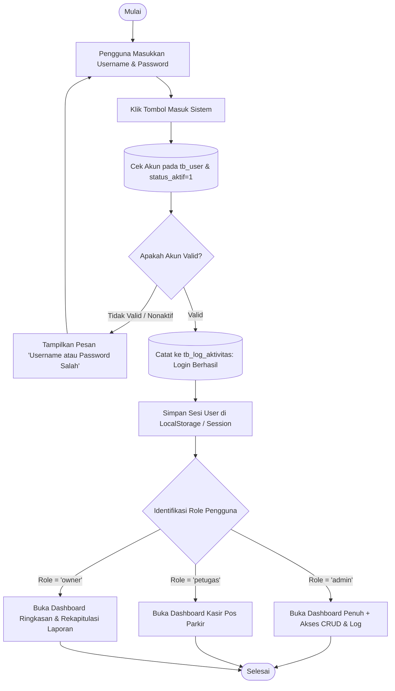
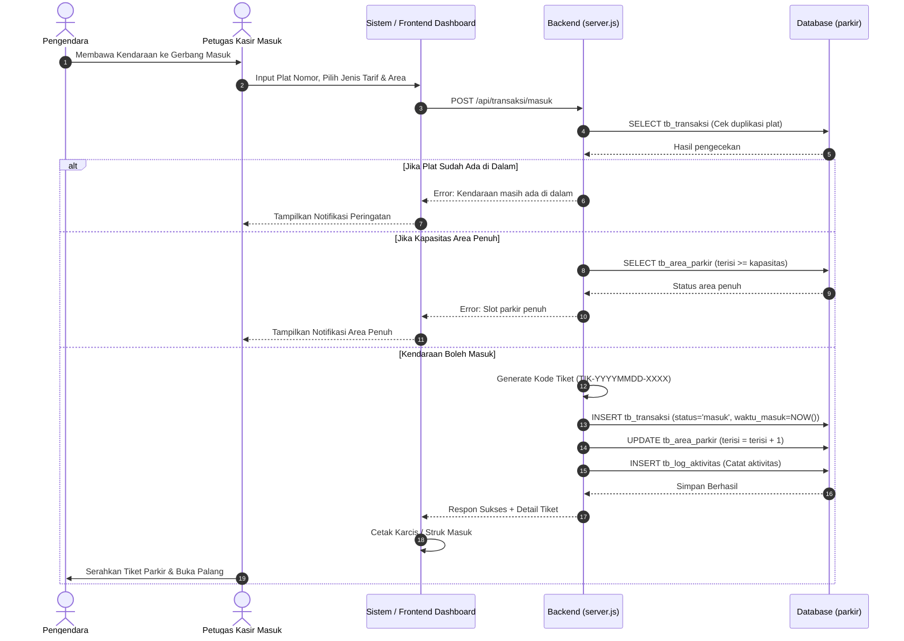
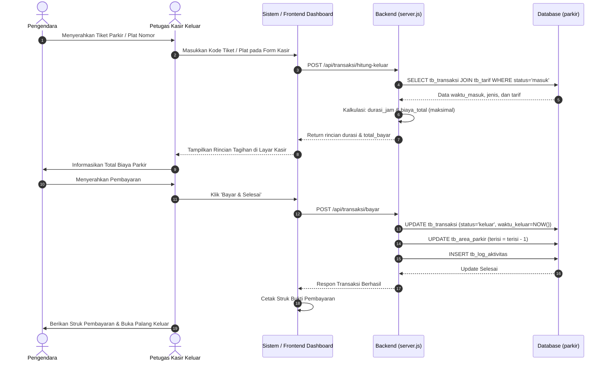
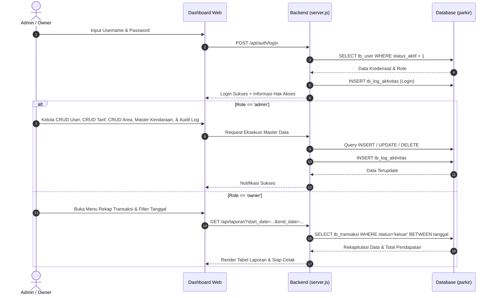

# DOKUMENTASI DIAGRAM: ACTIVITY & SWIMLANE
## Aplikasi Parkir (UKK RPL 2025/2026 - Paket 2)
### Standar Database SPK: `tb_user`, `tb_kendaraan`, `tb_tarif`, `tb_area_parkir`, `tb_transaksi`, `tb_log_aktivitas`

---

## 1. ACTIVITY DIAGRAM

Activity Diagram menggambarkan aliran kerja proses bisnis sistem secara terstruktur mulai dari titik mulai (*start*), percabangan (*decision*), hingga titik selesai (*end*).

### A. Activity Diagram: Proses Login Pengguna (3 Level)


### B. Activity Diagram: Transaksi Kendaraan Masuk (Check-In)
```mermaid
flowchart TD
    Start([Pengendara Datang]) --> B[Petugas Input Plat Nomor, Pilih Jenis Kendaraan & Area]
    B --> C[Klik Tombol Cetak Tiket Masuk]
    C --> D[(Cek tb_transaksi: Apakah Plat Masih Berstatus 'masuk'?)]
    
    D --> E{Plat Sudah di Dalam?}
    E -- Ya --> F[Tolak: Kendaraan Masih Berada di Dalam Area]
    F --> EndFail([Selesai])
    
    E -- Tidak --> G[(Cek tb_area_parkir: terisi < kapasitas?)]
    G --> H{Kapasitas Cukup?}
    H -- Penuh --> I[Tolak: Slot Area Parkir Sudah Penuh]
    I --> EndFail
    
    H -- Tersedia --> J[Generate Kode Tiket Otomatis: TIK-YYYYMMDD-XXXX]
    J --> K[(INSERT ke tb_transaksi: status='masuk', waktu_masuk=NOW())]
    K --> L[(UPDATE tb_area_parkir: terisi = terisi + 1)]
    L --> M[(INSERT ke tb_log_aktivitas: Kendaraan Masuk)]
    M --> N[Cetak Karcis / Struk Parkir Fisik]
    N --> O[Buka Palang Pintu Masuk / Barrier Gate]
    O --> EndSuccess([Kendaraan Masuk])
```

### C. Activity Diagram: Transaksi Kendaraan Keluar & Pembayaran (Check-Out)
```mermaid
flowchart TD
    Start([Pengendara Menuju Pos Keluar]) --> B[Petugas Input/Scan Kode Tiket atau Plat Nomor]
    B --> C[(SELECT dari tb_transaksi WHERE status='masuk')]
    C --> D{Data Tiket Ditemukan?}
    
    D -- Tidak Ditemukan --> E[Tampilkan Peringatan: Tiket Tidak Valid / Sudah Keluar]
    E --> EndFail([Selesai])
    
    D -- Ditemukan --> F[Hitung Durasi: ceil((waktu_keluar - waktu_masuk) / 1 Jam)]
    F --> G[Hitung Total Biaya: durasi_jam * tarif_per_jam]
    G --> H{Apakah Melebihi Tarif Maksimal?}
    H -- Ya --> I[biaya_total = tarif_maksimal]
    H -- Tidak --> J[biaya_total = total kalkulasi]
    
    I --> K[Tampilkan Rincian Durasi & Total Tagihan di Layar Kasir]
    J --> K
    K --> L[Pengendara Membayar Tunai / QRIS]
    L --> M[Petugas Konfirmasi Tombol Bayar & Selesai]
    M --> N[(UPDATE tb_transaksi: status='keluar', waktu_keluar=NOW(), biaya_total)]
    N --> O[(UPDATE tb_area_parkir: terisi = terisi - 1)]
    O --> P[(INSERT ke tb_log_aktivitas: Kendaraan Keluar)]
    P --> Q[Cetak Struk Bukti Pembayaran Parkir]
    Q --> R[Buka Palang Pintu Keluar]
    R --> EndSuccess([Kendaraan Keluar Selesai])
```

---

## 2. SWIMLANE DIAGRAM

Swimlane Diagram membagi alur kerja ke dalam **kolom / jalur peran (lane)**: Pengendara, Petugas Kasir, Sistem Backend, dan Database (`parkir`).

### A. Swimlane: Alur Masuk Kendaraan (Check-In)


### B. Swimlane: Alur Keluar Kendaraan & Pembayaran (Check-Out)


### C. Swimlane: Alur Hak Akses Admin & Owner

