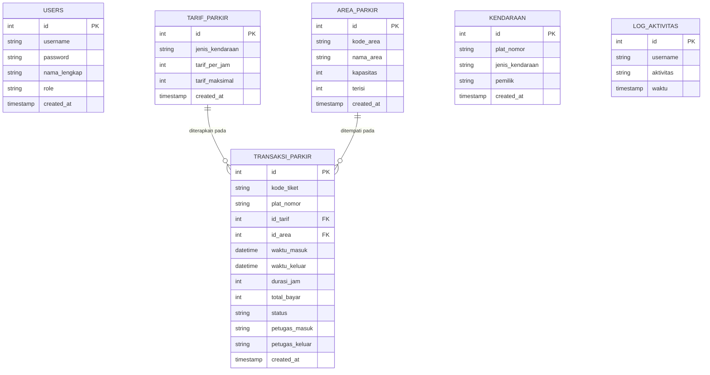
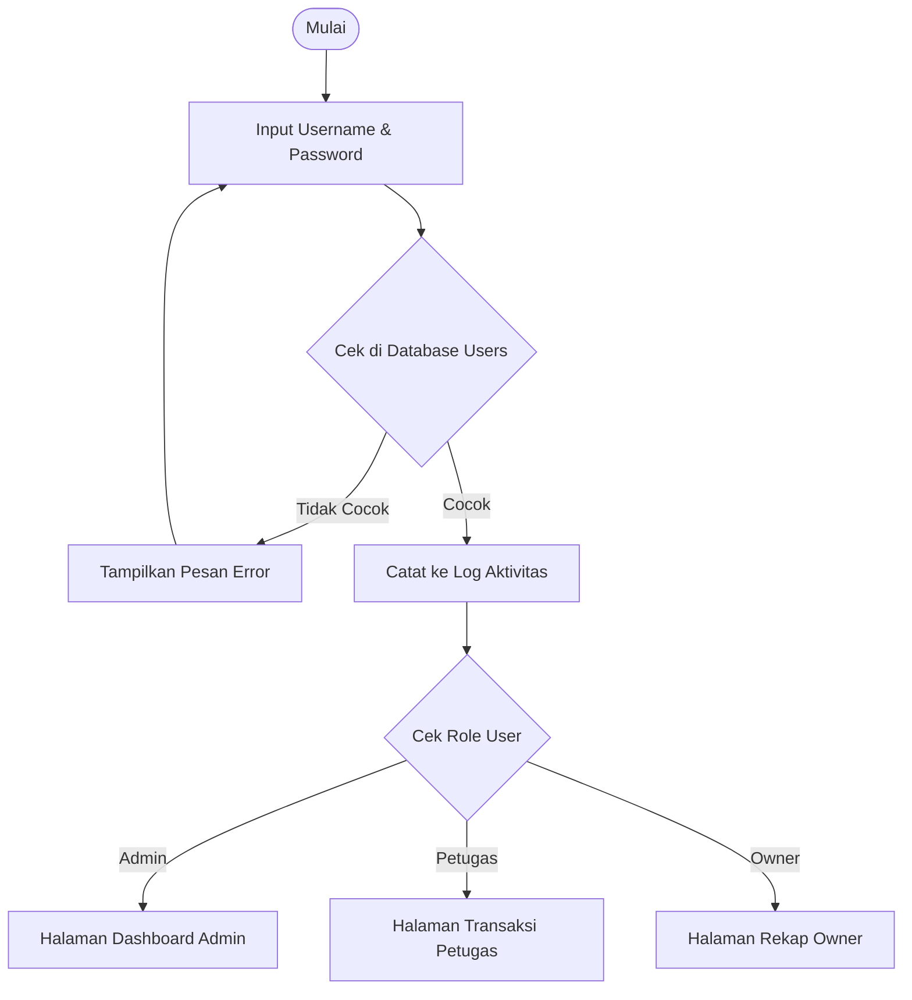
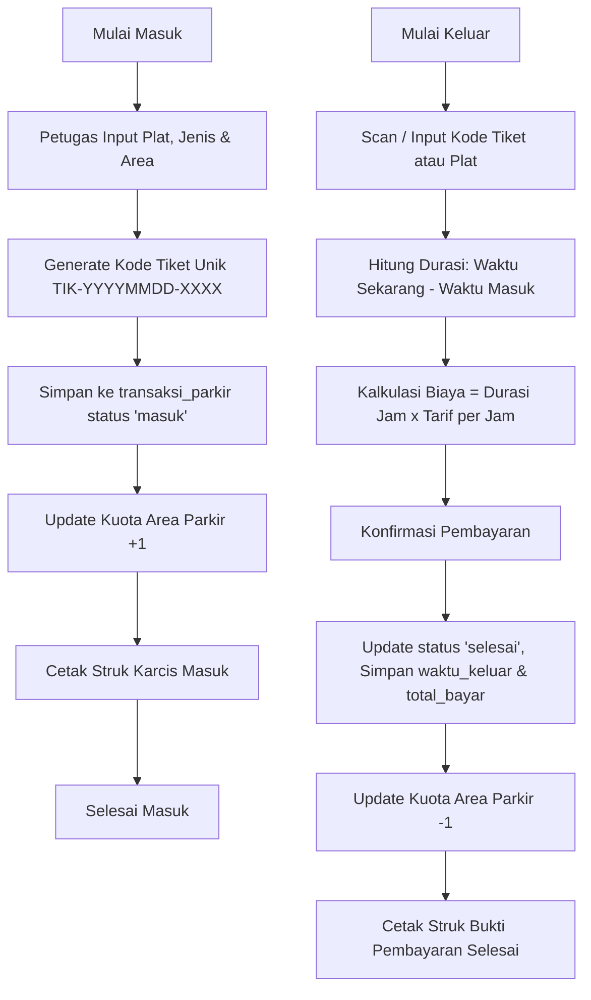

# DOKUMENTASI UJI KOMPETENSI KEAHLIAN (UKK) RPL
## Paket 2: Pengembangan Aplikasi Parkir (Tahun Pelajaran 2025/2026)

---

### 1. Deskripsi Program
Aplikasi Manajemen Parkir berbasis Fullstack JavaScript (Node.js Express + Vanilla ES6 Modern + MySQL) dengan arsitektur SPA (*Single Page Application*) yang ringan, responsif, dan bebas jeda (*smooth*). Sistem memiliki 3 level hak akses sesuai dengan dokumen standar ujian praktik:
1. **Admin**: Mengelola master data Pengguna (CRUD User), Tarif Parkir (CRUD Tarif), Area Parkir (CRUD Area), Master Kendaraan (CRUD Kendaraan), serta Akses Audit Log Aktivitas.
2. **Petugas**: Melayani transaksi kendaraan masuk (Check-in), transaksi keluar (Check-out) dengan kalkulasi tarif otomatis berdasarkan durasi, dan mencetak struk/karcis parkir.
3. **Owner**: Memantau ringkasan performa bisnis dan mencetak rekapitulasi laporan transaksi berdasarkan rentang tanggal tertentu.

---

### 2. Entity Relationship Diagram (ERD)

---

### 3. Diagram Alur (Flowchart) & Pseudocode

#### A. Alur Proses Login

#### B. Alur Proses Transaksi & Cetak Struk

---

### 4. Detail Modul, Fungsi, dan Prosedur (Dokumentasi Modul)

| No | Modul / Endpoint | Input | Proses | Output |
|---|---|---|---|---|
| 1 | `POST /api/auth/login` | `username`, `password` | Pencocokan kredensial di tabel `users` | Objek user & status login |
| 2 | `POST /api/transaksi/masuk` | `plat_nomor`, `id_tarif`, `id_area`, `petugas` | Generate barcode/kode tiket, tambah transaksi, kuota area +1 | Tiket parkir baru |
| 3 | `POST /api/transaksi/hitung-keluar` | `search` (kode/plat) | Selisih waktu keluar & masuk dibulatkan ke atas | Estimasi durasi & total bayar |
| 4 | `POST /api/transaksi/bayar` | `id`, `durasi_jam`, `total_bayar`, `petugas` | Set status 'selesai', update kuota area -1, log audit | Detail struk pembayaran |
| 5 | `GET /api/laporan` | `start_date`, `end_date` | Filter transaksi selesai dalam rentang tanggal | Rekapitulasi tabel & total omzet |

---

### 5. Laporan Evaluasi Singkat (Sesuai Poin 13 Dokumen UKK)
* **Fitur yang Sudah Berjalan dengan Baik**:
  1. Autentikasi 3 level peran (Admin, Petugas, Owner) dengan pembatasan hak menu sidebar.
  2. CRUD Master Data User, Tarif, Area, dan Kendaraan berjalan lancar dengan pencegahan bentrok relasi.
  3. Audit trail (Log Aktivitas) mencatat otomatis setiap aksi kritis.
  4. Transaksi parkir real-time dengan pencetakan struk pop-up (*receipt thermal friendly*).
  5. Rekapitulasi laporan keuangan fleksibel sesuai tanggal yang diminta owner dengan tombol cetak print laporan.
* **Bug yang Belum Diperbaiki**:
  - Nihil (Semua query dan validasi formulir terproteksi).
* **Rencana Pengembangan Berikutnya**:
  - Penambahan integrasi hardware gate barrier (Arduino/ESP32 relay).
  - Integrasi kamera OCR untuk pembacaan plat nomor otomatis.
  - Pembayaran non-tunai via QRIS dinamis.
