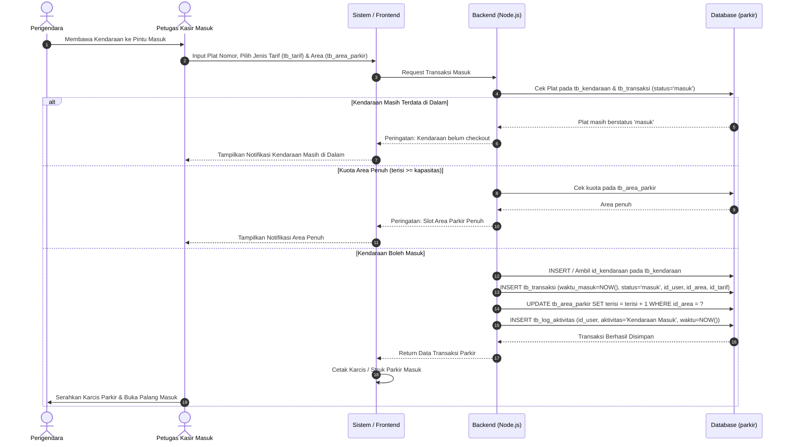
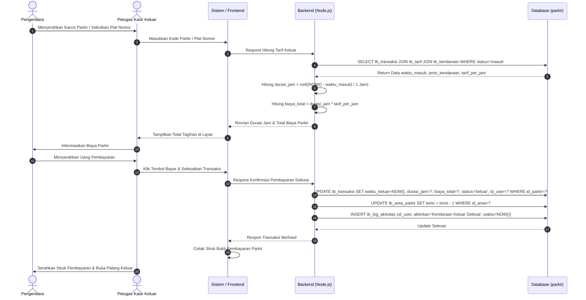
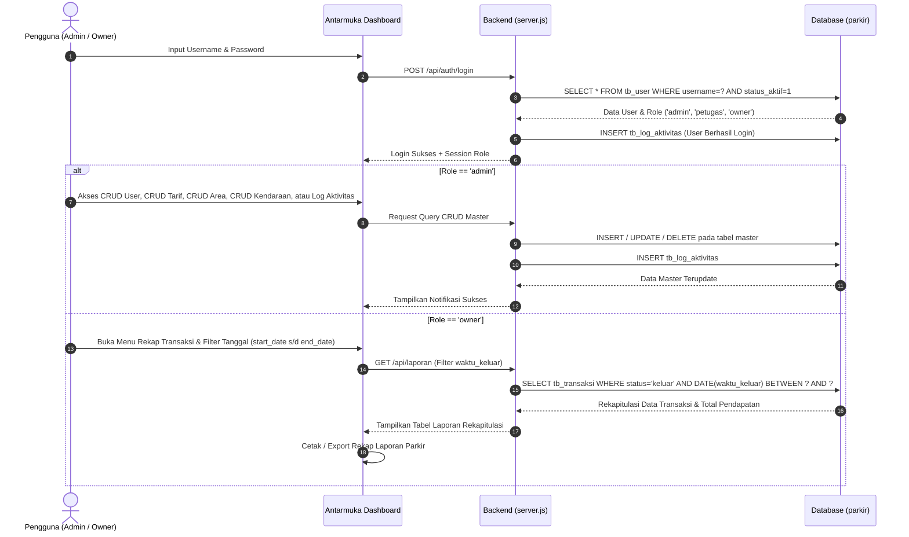

# UKK RPL 2025/2026 — Paket 2 (SPK Praktik Kejuruan)

- Kode: KM25.4.1.1 | Waktu: 11 jam | Perorangan
- **Judul: Pengembangan Aplikasi Parkir**

## Alat & bahan
PC/laptop (2 GHz, RAM 4 GB), internet ≥1 Mbps, OS, text editor/tools pemrograman, server basis data, debugging tools, aplikasi pengolah kata.

## Soal
Sebagai novice programmer, buat **Aplikasi Parkir dengan 3 level pengguna** (admin, petugas, owner).

### Skema database (database: `parkir`)
| Tabel | Kolom |
|---|---|
| tb_user | id_user int(11) PK, nama_lengkap varchar(50), username varchar(50), password varchar(100), role enum('admin','petugas','owner'), status_aktif tinyint(1) |
| tb_kendaraan | id_kendaraan int(11) PK, plat_nomor varchar(15), jenis_kendaraan varchar(20), warna varchar(20), pemilik varchar(100), id_user int(11) |
| tb_tarif | id_tarif int(11) PK, jenis_kendaraan enum('motor','mobil','lainnya'), tarif_per_jam decimal(10,0) |
| tb_area_parkir | id_area int(11) PK, nama_area varchar(50), kapasitas int(5), terisi int(5) |
| tb_transaksi | id_parkir int(11) PK, id_kendaraan int(11), waktu_masuk datetime, waktu_keluar datetime, id_tarif int(11), durasi_jam int(5), biaya_total decimal(10,0), status enum('masuk','keluar'), id_user int(11), id_area int(11) |
| tb_log_aktivitas | id_log int(11) PK, id_user int(11), aktivitas varchar(100), waktu_aktivitas datetime |

Relasi: tb_transaksi → tb_kendaraan, tb_tarif, tb_user, tb_area_parkir; tb_log_aktivitas → tb_user.

### Fitur per role
| Fitur | Admin | Petugas | Owner |
|---|:-:|:-:|:-:|
| Login / Logout | V | V | V |
| CRUD User | V | | |
| CRUD Tarif Parkir | V | | |
| CRUD Area Parkir | V | | |
| CRUD Kendaraan | V | | |
| Akses Log Aktivitas | V | | |
| Cetak struk parkir | | V | |
| Transaksi | | V | |
| Rekap transaksi sesuai waktu yang diminta | | | V |

---

## 3. Swimlane Diagram Proses Bisnis Sistem Parkir

Berikut adalah diagram Swimlane yang membagi alur kerja secara presisi berdasarkan 4 entitas peran: **Pengendara**, **Petugas Kasir**, **Sistem Aplikasi (Backend)**, dan **Database (`parkir`)**:

### A. Swimlane: Transaksi Kendaraan Masuk (Check-In) & Cetak Struk

### B. Swimlane: Transaksi Kendaraan Keluar (Check-Out) & Cetak Struk Pembayaran

### C. Swimlane: Hak Akses Admin (CRUD Master & Log) dan Owner (Rekap Laporan)

---

## Langkah kerja
1–4. Siapkan komputer, install OS & software, pastikan jalan.
5. Buat struktur data + akses data (tipe data, control program).
6. Metode Waterfall/prototype: analisis kebutuhan → desain (ERD & diagram program) → implementasi → pengujian → dokumentasi.
7. **Deskripsi + flowchart/pseudocode minimal untuk: (a) login, (b) transaksi, (c) cetak struk.**
8. Dokumentasi per modul: input, proses, output + fungsi/prosedur/method.
9. Buat database dari ERD.
10. Buat folder projek, jalankan aplikasi yang dibutuhkan.
11. Coding guidelines & best practice: query efisien, pakai prosedur & fungsi, pakai array, hindari loop tak perlu, pakai LIMIT untuk data besar.
12. Debugging & perbaiki error.
13. Laporan singkat: fitur yang jalan, bug yang belum diperbaiki, rencana pengembangan.

## Yang dikumpulkan
1. Folder proyek (kode lengkap)
2. Database `.sql`
3. Dokumentasi: ERD, deskripsi program, dokumentasi fungsi/prosedur, debugging
4. Laporan evaluasi singkat
