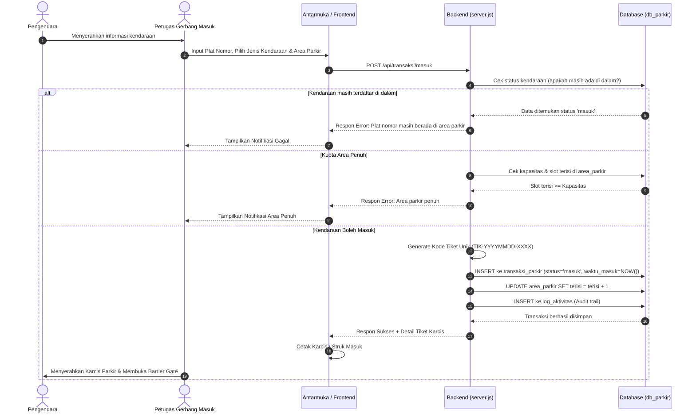
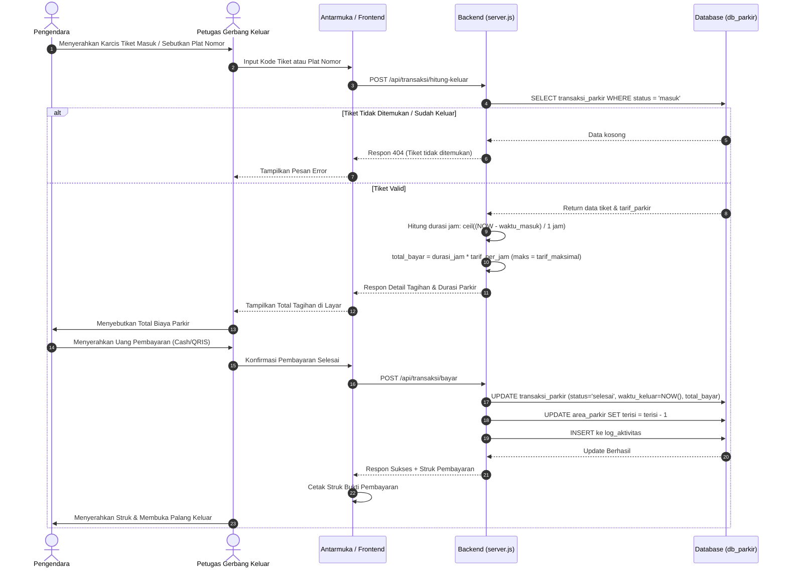
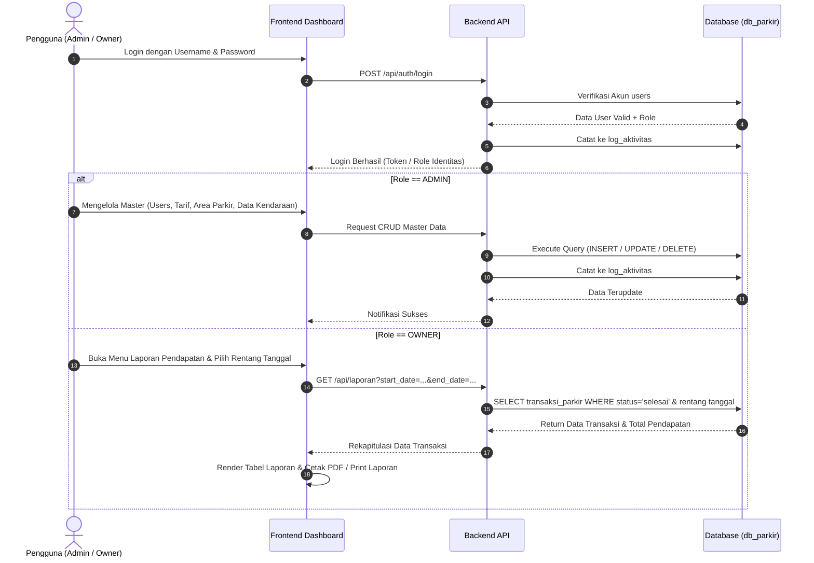

# DOKUMENTASI & DIAGRAM SWIMLANE APLIKASI PARKIR
## Berdasarkan Dokumen Uji Kompetensi Keahlian (UKK) / SPK Paket 2

---

## 1. Swimlane Diagram: Alur Kendaraan Masuk (Check-In)

Diagram ini membagi tanggung jawab antara **Pengendara / Pelanggan**, **Petugas Kasir Masuk**, dan **Sistem (Backend & Database)** saat mencetak tiket parkir baru.

---

## 2. Swimlane Diagram: Alur Kendaraan Keluar & Pembayaran (Check-Out)

Diagram proses validasi karcis, kalkulasi tarif berbasis durasi otomatis, dan cetak struk pembayaran akhir.

---

## 3. Swimlane Diagram: Alur Manajemen Master & Laporan (Admin & Owner)

