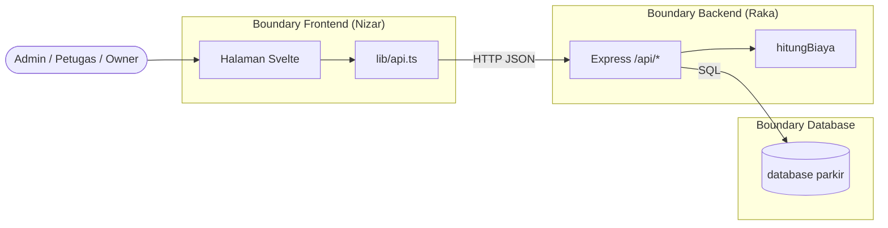
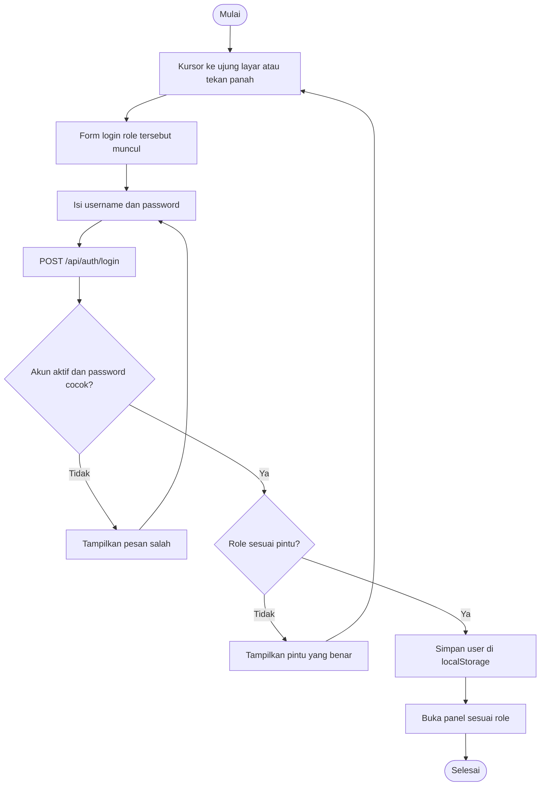
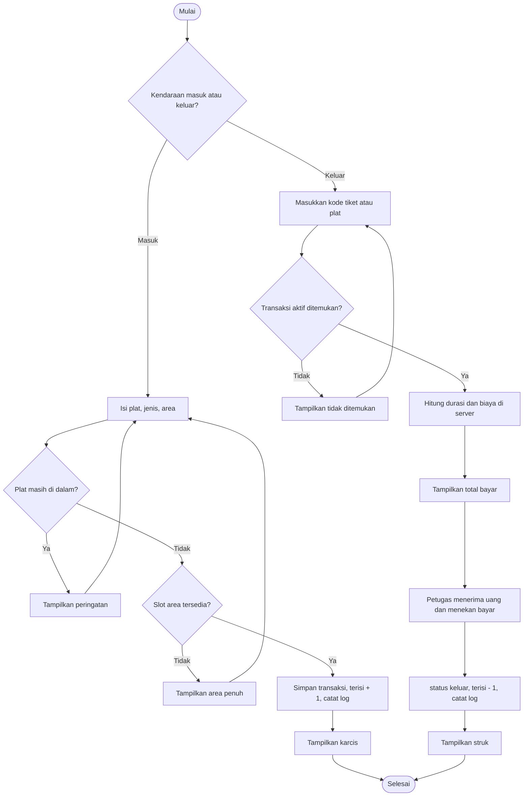
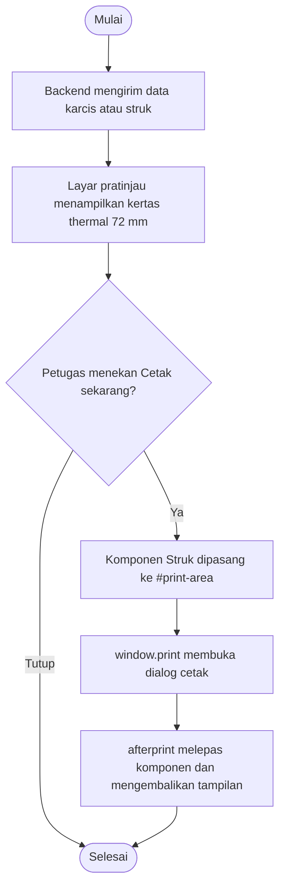

# Deskripsi Program

Parkir Bebas adalah aplikasi web untuk mencatat kendaraan masuk dan keluar, menghitung biaya parkir, mencetak karcis dan struk, serta merekap pendapatan. Aplikasi punya 3 level pengguna: admin, petugas, dan owner.

## Teknologi

| Bagian | Teknologi | Folder |
|---|---|---|
| Frontend | Svelte 5, TypeScript, Vite, WebGL, CSS 3D | `frontend/` |
| Backend | Node.js, Express 5, mysql2, bcryptjs | `backend/` |
| Database | MySQL / MariaDB | `database_spk_asli.sql` |

## Hak akses

| Fitur | Admin | Petugas | Owner |
|---|:-:|:-:|:-:|
| Login dan logout | V | V | V |
| Dashboard kondisi parkir | V | V | V |
| CRUD user, tarif, area, kendaraan | V | | |
| Log aktivitas | V | | |
| Transaksi masuk dan keluar, cetak karcis dan struk | | V | |
| Rekap transaksi per rentang tanggal, cetak, export CSV | | | V |

Pembatasan halaman saat ini ada di frontend (`AKSES` di `frontend/src/App.svelte`). Backend belum memeriksa login dan role, lihat [LAPORAN_EVALUASI.md](LAPORAN_EVALUASI.md).

## Boundary dan pembagian tugas

Frontend dan backend hanya berhubungan lewat API `/api/*` berformat JSON. Frontend tidak menyentuh database.



| Boundary | Tanggung jawab |
|---|---|
| Frontend | Tampilan, validasi isian, format angka dan tanggal, cetak, export CSV |
| Backend | Aturan bisnis, hitung biaya, simpan data, hash password, catat log |
| Database | Menyimpan data dan menjaga relasi antartabel |

## Flowchart (a) Login



## Flowchart (b) Transaksi



Rumus biaya:

```
durasi_jam  = bulatkan_ke_atas(selisih waktu / 1 jam), minimal 1
biaya_total = durasi_jam × tarif_per_jam
```

Contoh: parkir 1 jam 10 menit dengan tarif Rp 5.000 dihitung 2 jam, jadi Rp 10.000.

## Flowchart (c) Cetak struk



## Cara menjalankan

Butuh dua terminal, karena frontend dan backend jalan terpisah.

Terminal 1, backend:

```
mysql -u root < database_spk_asli.sql
cd backend
npm install
node server.js
```

Terminal 2, frontend:

```
cd frontend
npm install
npm run dev
```

Buka http://localhost:5173. Semua akun awal memakai password `123456`, dengan username `admin`, `petugas`, dan `owner`.
