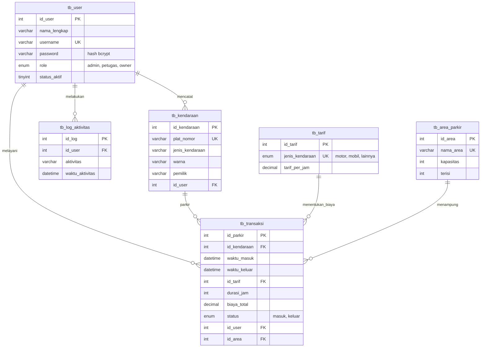

# ERD Aplikasi Parkir

Database: `parkir`. Skema lengkap ada di `database_spk_asli.sql`.

## Penjelasan tabel

| Tabel | Fungsi |
|---|---|
| `tb_user` | Akun admin, petugas, dan owner |
| `tb_tarif` | Tarif per jam untuk tiap jenis kendaraan |
| `tb_area_parkir` | Kapasitas dan jumlah terisi tiap area |
| `tb_kendaraan` | Data kendaraan, satu baris untuk satu plat |
| `tb_transaksi` | Satu baris untuk satu kali parkir, dari masuk sampai keluar |
| `tb_log_aktivitas` | Catatan login, logout, perubahan data, dan transaksi |

## Relasi

- Satu kendaraan bisa punya banyak transaksi, tapi hanya satu yang berstatus `masuk` pada satu waktu.
- `tb_transaksi.id_user` berisi petugas yang terakhir melayani. Saat kendaraan keluar, nilainya diganti petugas keluar.
- Kalau user dihapus, `id_user` di kendaraan, transaksi, dan log menjadi `NULL`, jadi riwayatnya tetap ada.
- Tarif, area, dan kendaraan yang sudah dipakai transaksi tidak bisa dihapus.
